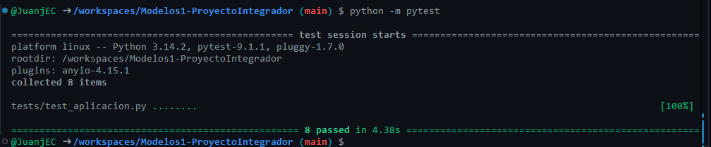

# Proyecto integrador: precio de vehiculos usados en UAE

Modelo predictivo, scripts de entrenamiento y prediccion, API REST y monitoreo.

# Fase 1: Modelo predictivo. Precio de vehiculos usados en UAE

Modelos y Simulacion de Sistemas I, Universidad de Antioquia. Docente: Andres Parra.

**Integrantes:** Andres Felipe Borja Usuga, Juan Jeronimo Echeverry Chica, Cristian Mateo Sepulveda Ochoa.

## Descripcion del problema

Regresion: predecir el precio (`Price`, en AED) de un vehiculo usado a partir de sus caracteristicas.

## Fuente del conjunto de datos

Kaggle, "UAE Used Cars Analysis": https://www.kaggle.com/datasets/mohamedsaad254/uae-used-cars-analysis-full-project-v1-0 (archivo `uae_used_cars_10k.csv`, 10.000 filas, 11 variables predictoras). Contiene 105 nulos en `Cylinders` (1,05 %) y ademas 50 valores `Unknown` en esa misma columna.

## Objetivo del modelo

Estimar el precio de un vehiculo usado y compararlo contra un modelo base.

## Algoritmo

Pipeline de scikit-learn: imputacion (mediana / moda), `StandardScaler`, `OneHotEncoder`, TF-IDF sobre `Description` (300 terminos) y `RandomForestRegressor` (120 arboles, profundidad 20). Modelo base: `DummyRegressor` con la mediana. Seleccion por validacion cruzada de 3 particiones usando solo el entrenamiento (Dummy, Ridge, Random Forest).

## Metrica

MAE (principal), RMSE y R2, sobre un conjunto de prueba del 20 % (semilla 42).

## Resultados

| Metrica | Random Forest |
|---|---|
| MAE | 118341.93 |
| RMSE | 388796.19 |
| R2 | 0.42 |

Fuga de informacion: la separacion train/test se hace antes de ajustar cualquier transformacion; todo el preprocesamiento esta dentro de un `Pipeline` ajustado solo con entrenamiento; `Price` se usa solo como objetivo.

## Contenido de la carpeta

- `notebook.ipynb`: analisis, preparacion, modelos, evaluacion y guardado.
- `modelo.joblib`: pipeline completo entrenado.
- `README.md`: este archivo.

# Fase 2: Scripts y Docker. Prediccion de precios de vehiculos usados (UAE)

**Entrega 2, commit o etiqueta:** `entrega-2`.

## Problema y relacion con la Fase 1

Regresion: predecir `Price` (AED) de un vehiculo usado a partir de 11 variables (`Make`, `Model`, `Year`, `Mileage`, `Body Type`, `Cylinders`, `Transmission`, `Fuel Type`, `Color`, `Location`, `Description`).
Se conservan el dataset y el enfoque de la Fase 1 (Pipeline con imputacion, escalado, One-Hot, TF-IDF y Random Forest; baseline `DummyRegressor` con la mediana). El notebook se conserva en `notebook.ipynb`.

## Cambios respecto a la Fase 1

- El notebook se convirtio en scripts: `train.py` y `predict.py`, con la logica compartida en `src/`.
- La limpieza determinista (`Cylinders` no numerico a nulo, `Description` nula a texto vacio) ahora **vive dentro del Pipeline**, asi el artefacto guardado es autosuficiente.
- Correccion de calidad de datos: `Location` traia espacios al inicio (`" Dubai"` y `"Dubai"` se contaban como categorias distintas, 16 en total en vez de 8). Ahora se hace `strip` en todas las categoricas. Por eso el MAE de v1 (118404) difiere levemente del de la Fase 1 (118342).
- Se agrega la opcion `--log-target` (entrena sobre log(1+Price)), usada en v2, porque `Price` es muy asimetrico y asi la prediccion nunca es negativa.
- No hay identificadores de grupo y no existen filas repetidas en las variables predictoras, por eso la separacion es aleatoria 80/20 (justificado en `src/training.py`).

## Requisitos y entorno

- **Python 3.14.2** (el mismo en local y en Docker). Dependencias con versiones fijas en `requirements.txt`.

Bash (Linux/macOS):
```bash
python3.14 -m venv .venv
source .venv/bin/activate
pip install -r requirements.txt
```
PowerShell (Windows):
```powershell
py -3.14.2 -m venv .venv
.venv\Scripts\Activate.ps1
pip install -r requirements.txt
```

## Datos

- Fuente: Kaggle, "UAE Used Cars Analysis" https://www.kaggle.com/datasets/mohamedsaad254/uae-used-cars-analysis-full-project-v1-0 (archivo `uae_used_cars_10k.csv`, 10.000 filas).
- El CSV (1,9 MB) esta incluido en `data/uae_used_cars_10k.csv`. Si no estuviera, descargarlo de Kaggle y dejarlo en esa ruta.
- Esquema del CSV de prediccion (`data/ejemplo_prediccion.csv`): las 11 columnas predictoras, **sin** `Price`. El orden de columnas no importa.

| Columna | Tipo | Nulos |
|---|---|---|
| Year, Mileage | numerico | se imputan con la mediana de entrenamiento |
| Cylinders | numerico (acepta "Unknown", que pasa a nulo) | mediana |
| Make, Model, Body Type, Transmission, Fuel Type, Color, Location | texto | moda de entrenamiento |
| Description | texto libre | texto vacio |

Reglas de prediccion: columna requerida ausente o `Year`/`Mileage` no numericos dan error claro y codigo de salida distinto de cero (no se genera el CSV). Columnas extra se ignoran (y se conservan en la salida). Categorias no vistas en entrenamiento se ignoran (One-Hot en ceros). Se predice una fila por fila de entrada, en el mismo orden.

## Uso

Todos los comandos se ejecutan en **una sola linea**.

```bash
python train.py --help
python predict.py --help

python train.py --data data/uae_used_cars_10k.csv --target Price --output-dir models --version v1 --seed 42
python train.py --data data/uae_used_cars_10k.csv --target Price --output-dir models --version v2 --seed 42 --log-target

python predict.py --model models/v1/modelo.joblib --input data/ejemplo_prediccion.csv --output outputs/predicciones.csv
python predict.py --model models/v2/modelo.joblib --input data/ejemplo_prediccion.csv --output outputs/predicciones_v2.csv
```
Repetir un `--version` existente se rechaza con un error (no se sobrescribe).
Salida: `outputs/predicciones.csv` = columnas de entrada + `prediccion` (precio en AED).

## Versiones del modelo

```
models/
  v1/  modelo.joblib  metrics.json  metadata.json   # Random Forest (como Fase 1)
  v2/  modelo.joblib  metrics.json  metadata.json   # Random Forest con --log-target
```

## Resultados (conjunto de prueba, 2.000 filas, semilla 42)

Metrica principal: MAE (AED), con RMSE y R2. Baseline: predecir siempre la mediana del precio de entrenamiento.

| Modelo | MAE | RMSE | R2 |
|---|---|---|---|
| Baseline (mediana) | 192459.92 | 532043.08 | -0.0797 |
| v1 Random Forest | 118404.02 | 388746.29 | 0.4236 |
| v2 Random Forest + log(1+Price) | 109280.51 | 385337.72 | 0.4336 |

Ambas versiones mejoran al baseline. El R2 moderado indica que el precio tiene mucha variacion que las variables no explican.

**Limitaciones:** `Price` muy asimetrico con vehiculos de lujo muy caros (el RMSE es alto por eso); `Description` repite informacion de otras columnas; una sola particion train/test (sin validacion cruzada en los scripts); el Random Forest tiene componentes aleatorios, fijados con la semilla, pero pueden aparecer diferencias numericas minimas entre sistemas.

## Pruebas

```bash
python -m pytest
```
La fase 2 tiene 8 pruebas con datos sinteticos y `tmp_path` (el conjunto completo de fases 2 a 4 tiene 37 pruebas): (1) entrenamiento y archivos de la version, (2) carga y prediccion igual al modelo en memoria, (3) valores faltantes, (4) columna ausente y tipo invalido (incluye la CLI con codigo de salida distinto de cero), (5) versionamiento (segunda version conserva la primera, id repetido no sobrescribe), y (6) categorias nuevas, columnas extra y orden de columnas.

## Docker

Bash:
```bash
docker build -t modelos-fase2:1.0 .
mkdir -p models outputs
docker run --rm -v "$PWD/data:/app/data:ro" -v "$PWD/models:/app/models" modelos-fase2:1.0 python train.py --data data/uae_used_cars_10k.csv --target Price --output-dir models --version v-docker --seed 42
docker run --rm -v "$PWD/data:/app/data:ro" -v "$PWD/models:/app/models:ro" -v "$PWD/outputs:/app/outputs" modelos-fase2:1.0 python predict.py --model models/v-docker/modelo.joblib --input data/ejemplo_prediccion.csv --output outputs/predicciones_docker.csv
docker run --rm modelos-fase2:1.0 python -m pytest -q
```
PowerShell: igual, cambiando `$PWD` por `${PWD}` y `mkdir -p` por `mkdir models, outputs -Force`.

El entrenamiento NO ocurre en `docker build`; `models/` y `outputs/` persisten en el equipo anfitrion por los montajes.

## Evidencia de ejecucion


Verificacion de fases 3 y 4 en Docker: [evidencia/resultado.txt](evidencia/resultado.txt).

# Fases 3 y 4: API REST y monitoreo

Se agregaron una API FastAPI en `fase-3/api.py`, un cliente HTTP en `fase-3/cliente.py` y monitoreo en `src/monitoring.py` y `fase-4/monitoreo.py`. Se reutilizan el entrenamiento, la prediccion y los modelos de la fase 2.

## API y configuracion

| Operacion | Resultado |
|---|---|
| `GET /health` | HTTP 200, `{"estado":"ok"}`. Indica que el proceso vive, no garantiza disponibilidad del modelo. |
| `POST /predict` | Un registro JSON, HTTP 200 con `prediccion` en AED y `version`. No requiere `Price`. |
| `POST /train` | Cuerpo vacio o `{}`. HTTP 201 al terminar y guardar `modelo.joblib`, `metrics.json`, `metadata.json` en una carpeta nueva. |

Variables de entorno (se leen al iniciar el servidor):

| Variable | Por defecto | Uso |
|---|---|---|
| `MODEL_VERSION` | `v2` | Selecciona `models/<version>/modelo.joblib`. |
| `MODELS_DIR` | `models/` del repositorio | Almacenamiento de versiones. |
| `TRAIN_DATA` | `data/uae_used_cars_10k.csv` | Datos de entrenamiento; objetivo `Price`. |
| `PREDICTION_LOG` | `outputs/solicitudes.jsonl` | Registro JSONL persistente. |

Las rutas relativas configuradas se resuelven desde el directorio de trabajo; en Docker usar rutas `/app/...`. `/train` conserva la configuracion de v2: semilla 42, division 80/20, Random Forest de 120 arboles, profundidad 20, minimo 2 por hoja, TF-IDF 300 y `log(1+Price)`. Genera un identificador unico de version y responde sin activar la candidata. Es sincronico y puede tardar; no interrumpir la solicitud.

Todas las claves predictoras son obligatorias aunque su valor sea `null`. `Year` y `Mileage` deben ser numeros JSON, no cadenas ni booleanos. Las categoricas y `Description` son texto o `null`; `Cylinders` acepta numero, texto (como `Unknown`) o `null`. Los nulos usan mediana/moda/texto vacio del Pipeline guardado. Los campos extra se ignoran. Un campo ausente o tipo incompatible produce 422 con su nombre; modelo ausente o ilegible produce 503 comprensible. La API carga solo artefactos de confianza del repositorio: `joblib` no es seguro para archivos recibidos de desconocidos.

Ejemplo real, primera fila de `data/ejemplo_prediccion.csv`:

```json
{"Make":"toyota","Model":"rush","Year":2022,"Mileage":291202,"Body Type":"SUV","Cylinders":4,"Transmission":"Automatic Transmission","Fuel Type":"Gasoline","Color":"Brown","Location":" Dubai","Description":"2022 toyota rush with Bluetooth, Adaptive cruise control. Condition: Repainted bumper."}
```

Respuesta observada con v2:

```json
{"prediccion":58252.04,"version":"v2"}
```

## Ejecucion de la API con Docker

Desde la raiz del repositorio, en Bash (por ejemplo, GitHub Codespaces):

```bash
mkdir -p models outputs
docker build -t modelos-api:3.0 .
docker run --rm --name modelos-api -p 8000:8000 -e MODEL_VERSION=v2 -e PREDICTION_LOG=/app/outputs/solicitudes.jsonl -v "$PWD/data:/app/data:ro" -v "$PWD/models:/app/models" -v "$PWD/outputs:/app/outputs" modelos-api:3.0
```

Dejar el servidor abierto. `data/` se monta en modo lectura; las versiones nuevas quedan en `models/` y el registro persiste en `outputs/`. En otra terminal, desde la raiz:

```bash
curl -fsS http://localhost:8000/health
python fase-3/cliente.py
python fase-3/cliente.py --invalid
python fase-4/monitoreo.py --log outputs/solicitudes.jsonl
curl -sS -X POST http://localhost:8000/train -H 'Content-Type: application/json' -d '{}'
```

El cliente usa la primera fila de `data/ejemplo_prediccion.csv`; `--invalid` omite `Mileage` y debe devolver HTTP 422 y codigo de salida 1. El resumen acumula las solicitudes del archivo; para repetir desde cero, configurar `PREDICTION_LOG` con otro archivo dentro de `/app/outputs` y consultar ese archivo con el script. `/train` devuelve HTTP 201 y la nueva version al terminar; sus artefactos quedan en `models/<version>/` y v2 sigue activa. Detener el servidor con `Ctrl+C`.

Para ejecutar todas las pruebas dentro de la imagen:

```bash
docker run --rm modelos-api:3.0 python -m pytest -q
```

La verificacion integrada automatica es `bash probar.sh`; construye la imagen, ejecuta las pruebas, envia dos predicciones validas y una invalida, calcula el monitoreo y comprueba `/train`. En Codespaces, mantener el puerto 8000 privado; la API es una demostracion sin autenticacion.

## Monitoreo, versiones y politica

Cada `POST /predict` escribe una linea JSONL al conocer su resultado, incluidos JSON malformados, campos ausentes y errores del modelo. Los eventos contienen `fecha_hora` UTC, `estado_http`, `version` y `prediccion`; los dos ultimos pueden ser `null` en errores. `/health` y `/train` no se cuentan. El archivo se abre en modo agregar y no se borra al reiniciar; en Docker se monta fuera del contenedor.

```bash
python fase-4/monitoreo.py --log outputs/solicitudes.jsonl
python fase-4/monitoreo.py --log fase-4/registro_muestra.jsonl
```

Se cuentan como fallidas las respuestas 400 a 599. Un registro ausente o vacio produce total 0 y porcentaje `sin solicitudes`; uno corrupto da un error con el numero de linea. El registro no almacena los atributos del vehiculo.

Version activa: **v2**, en `models/v2/`; version anterior: **v1**, en `models/v1/`. Para volver a v1, detener y recrear el contenedor cambiando `-e MODEL_VERSION=v2` por `-e MODEL_VERSION=v1`, con el mismo montaje de modelos. Para activar una candidata se usa su identificador de la misma manera; ninguna llamada a `/train` cambia automaticamente la version activa.

**Politica de reentrenamiento:** al reunir 100 anuncios nuevos de vehiculos UAE con su precio real conocido, el equipo revisara el modelo y Juan ejecutara `/train` con un CSV actualizado que incluya esos casos. Comparara candidata y version activa por MAE en AED sobre el mismo conjunto reservado, sin incluir esos casos de evaluacion en el entrenamiento; activara la candidata solo si reduce el MAE al menos un 5 %. Si no mejora o falla la validacion, conservara v2 y mantendra v1 disponible para volver atras.

### Reporte

Ejecucion HTTP real con Uvicorn en `127.0.0.1:8013`, Python 3.12.14 y las dependencias del proyecto; **no es una evidencia de Docker**. El artefacto v2 existente se cargo correctamente y produjo el valor del ejemplo. Registro: `fase-4/registro_muestra.jsonl`.

| Solicitud | Resultado |
|---|---|
| Primera fila del CSV, completa | 200, v2, 58252.04 AED |
| Misma fila, completa | 200, v2, 58252.04 AED |
| Misma fila sin `Mileage` | 422, sin version ni prediccion |

Indicadores obtenidos: **3 solicitudes**, **1 fallida**, **33,3 % de fallos**. La falla fue el rechazo esperado de una entrada incompleta; no demuestra deterioro del modelo ni mide exactitud predictiva.

Se comprobo `/train` por HTTP: respondio **201** y guardo una nueva version en `models/` con modelo, metricas y metadatos, conservando v1 y v2. La candidata obtuvo MAE 109280.51, RMSE 385337.72 y R2 0.4336; al usar la misma configuracion y datos de v2, no aporta mejora ni se activa.

La verificacion posterior en Docker desde GitHub Codespaces obtuvo **37 pruebas aprobadas**, dos respuestas 200, una 422 esperada, 3 solicitudes y 33,3 % de fallos; `/train` respondio 201 y genero una version nueva. La salida completa esta en [evidencia/resultado.txt](evidencia/resultado.txt). Esta es una ejecucion distinta de la muestra de registro anterior.

## Fuentes

Documentacion de scikit-learn (Pipeline, ColumnTransformer, TransformedTargetRegressor), dataset de Kaggle citado arriba. Codigo adaptado del notebook de la Fase 1 del equipo.
